# Bank Sampah — Buku Tabungan

Aplikasi buku tabungan digital berbasis web untuk membantu pengelolaan bank sampah secara rapi, transparan, dan mudah digunakan. Petugas dapat mencatat setoran sampah maupun penarikan saldo dari komputer atau ponsel, sementara nasabah dapat memantau saldo, mutasi, serta kontribusi lingkungannya kapan saja.

Dibangun dengan **Astro 7 (SSR)**, **Prisma 7**, **PostgreSQL**, dan **shadcn/ui** — dapat dipasang gratis di **Vercel + Neon** maupun di **VPS sendiri** menggunakan Docker Compose. Seluruh identitas bank sampah (nama, kontak, warna tema, hingga jenjang penghargaan nasabah) bisa disesuaikan langsung dari halaman Pengaturan tanpa mengubah kode.

---

## Daftar Isi

- [Akun Demo](#akun-demo)
- [Fitur Utama](#fitur-utama)
- [Tampilan Aplikasi](#tampilan-aplikasi)
  - [Dashboard & Dampak Lingkungan](#dashboard--dampak-lingkungan)
  - [Login, Data Nasabah & Buku Tabungan](#login-data-nasabah--buku-tabungan)
  - [Cetak Rekening Koran](#cetak-rekening-koran)
  - [Transaksi Setor, Tarik & Koreksi](#transaksi-setor-tarik--koreksi)
  - [Pengguna, Impor/Ekspor Excel & Pengaturan](#pengguna-imporekspor-excel--pengaturan)
  - [Tampilan Nasabah di Ponsel](#tampilan-nasabah-di-ponsel)
  - [Tampilan Admin di Ponsel](#tampilan-admin-di-ponsel)
- [Menjalankan di Komputer Lokal](#menjalankan-di-komputer-lokal)
- [Deploy ke Vercel](#deploy-ke-vercel)
- [Deploy ke VPS Sendiri (Docker Compose)](#deploy-ke-vps-sendiri-docker-compose)
- [Pengaturan & Kustomisasi](#pengaturan--kustomisasi)
- [Impor & Ekspor Data Excel](#impor--ekspor-data-excel)
- [Penting: `ALLOWED_DOMAINS`](#penting-allowed_domains)
- [Struktur Proyek](#struktur-proyek)
- [Catatan Teknis & Keamanan](#catatan-teknis--keamanan)
- [Lisensi](#lisensi)

---

## Akun Demo

Untuk mencoba aplikasi secara langsung, gunakan kredensial berikut:

| Peran               | Username | Password     |
| ------------------- | -------- | ------------ |
| **Admin / Petugas** | `admin`  | `admin-test` |
| **Nasabah**         | `dodo`   | `user-test`  |

> **Catatan:** Jika Anda memasang aplikasi ini untuk penggunaan nyata, pastikan segera mengganti password bawaan demi keamanan data.

---

## Fitur Utama

- **Untuk Admin & Petugas**: Ringkasan dashboard & grafik arus kas 30 hari, total dampak lingkungan kolektif, kelola data nasabah (nomor rekening otomatis), kelola jenis & harga sampah, catat setoran banyak jenis sekaligus, catat penarikan saldo, koreksi transaksi (_perbaiki/batalkan_) tanpa menghapus riwayat, cetak struk, cetak **rekening koran per nasabah (filter bulanan + saldo awal/akhir)** maupun **laporan mutasi global bulanan (+ rekap sampah per jenis)**, kelola akun pengguna, impor/ekspor Excel, serta halaman pengaturan 3 tab.
- **Untuk Nasabah**: Cek saldo dan mutasi harian langsung dari ponsel, filter mutasi per bulan & cetak rekening koran sendiri, pantau jenjang penghargaan dan estimasi pengurangan emisi karbon dari sampah yang disetor, lihat daftar harga sampah terbaru, cetak bukti transaksi, dan ubah password sendiri.
- **Pengalaman Cepat & Responsif**: Perpindahan halaman mulus tanpa _full reload_ (`ClientRouter` + _prefetch_), indikator _progress bar_ & _skeleton loading_, serta pembaruan parsial (_partial swap_) khusus area tabel/daftar saat ganti bulan, pencarian, atau pindah halaman paginasi sehingga kartu profil dan form tetap stabil.
- **Tema & Skema Warna Dinamis**: Mode tema terpusat (Terang, Gelap, atau Otomatis Perangkat) dikonfigurasi langsung oleh Admin dengan 8 preset warna (_Hijau Alam, Toska, Biru Samudra, Indigo, Ungu, Amber, Mawar, Slate_) atau pemilih warna kustom, dilengkapi kotak pratinjau kartu langsung (_live preview_). Seluruh kartu, border, dan elemen mobile beradaptasi secara harmonis dan nyaman di mata.
- **Format Angka Indonesia**: Nominal rupiah memakai titik sebagai pemisah ribuan (`1.500`) dan koma untuk desimal; berat sampah mendukung titik maupun koma (`1.5` atau `1,5` kg).

---

## Tampilan Aplikasi

### Dashboard & Dampak Lingkungan

Halaman utama admin merangkum total saldo seluruh nasabah, perkembangan jumlah nasabah, total sampah masuk, grafik arus kas 30 hari, komposisi sampah bulan berjalan, ringkasan transaksi terbaru, hingga estimasi emisi CO₂ yang berhasil dicegah bersama warga.

<p align="center">
  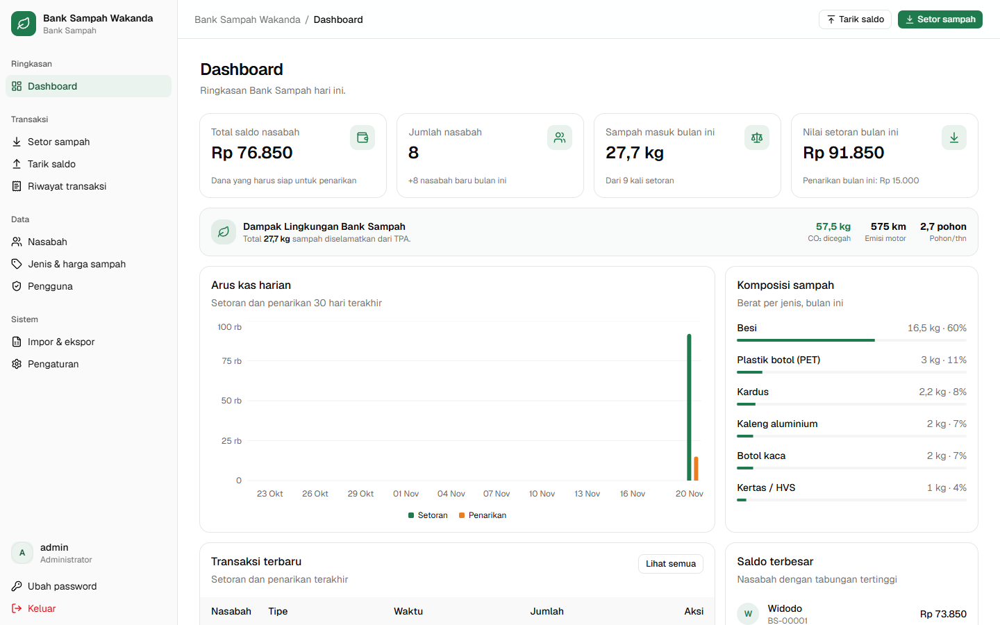
</p>

### Login, Data Nasabah & Buku Tabungan

Seluruh halaman dan data terlindungi oleh login berbasis sesi. Pada halaman nasabah, petugas bisa mencari data dengan cepat, melihat profil lengkap beserta lencana level penghargaan, memantau saldo berjalan, dan membuka bukti tiap transaksi.

<table>
  <tr>
    <td width="50%" align="center" valign="top">
      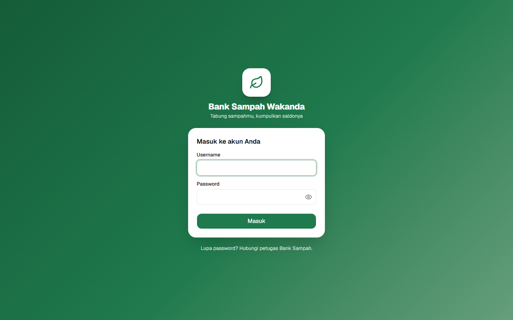
      <br /><sub><b>Halaman Login</b> — menampilkan nama &amp; kontak pengelola dari Pengaturan</sub>
    </td>
    <td width="50%" align="center" valign="top">
      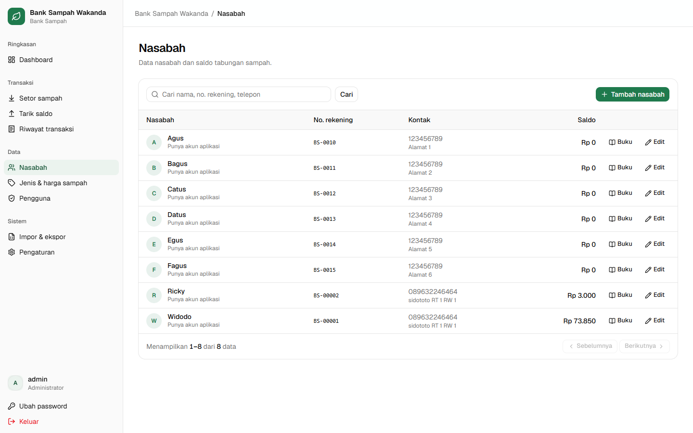
      <br /><sub><b>Daftar Nasabah</b> — dilengkapi pencarian cepat &amp; navigasi halaman</sub>
    </td>
  </tr>
  <tr>
    <td width="50%" align="center" valign="top">
      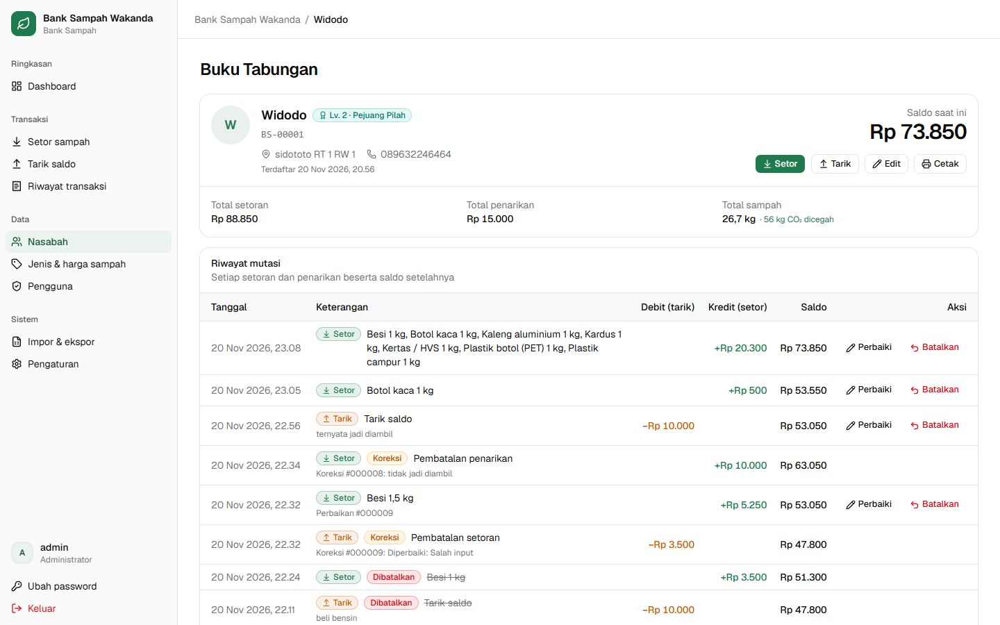
      <br /><sub><b>Buku Tabungan</b> — profil nasabah, lencana penghargaan &amp; mutasi saldo</sub>
    </td>
    <td width="50%" align="center" valign="top">
      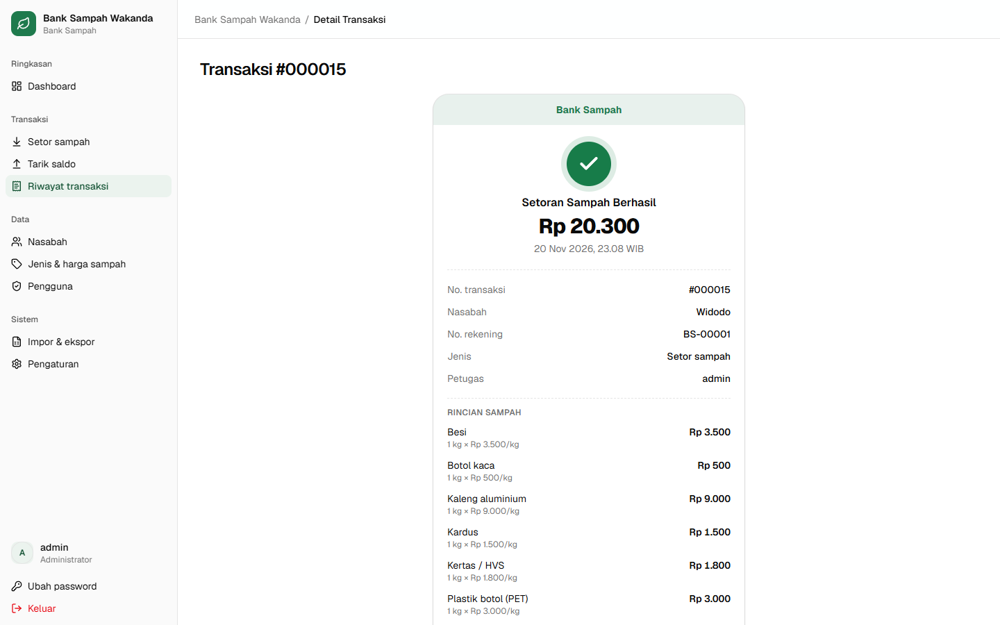
      <br /><sub><b>Bukti Transaksi</b> — rincian item sampah &amp; saldo akhir siap cetak</sub>
    </td>
  </tr>
</table>

### Cetak Rekening Koran

Menekan tombol **Cetak** di halaman Buku Tabungan (baik oleh petugas maupun nasabah) otomatis menghasilkan dokumen berformat rekening koran ukuran A4 lengkap dengan kop organisasi, **saldo awal & akhir periode** saat filter bulan dipilih, ringkasan saldo, nomor bukti, tabel mutasi kronologis, catatan kaki, dan ruang pengesahan petugas.

Pada halaman **Riwayat Transaksi**, admin juga dapat memilih bulan dan mencetak **Laporan Mutasi Global** untuk seluruh nasabah, dilengkapi ringkasan arus kas, rekap berat & nilai per jenis sampah, serta kolom pengesahan Bendahara dan Ketua.

<p align="center">
  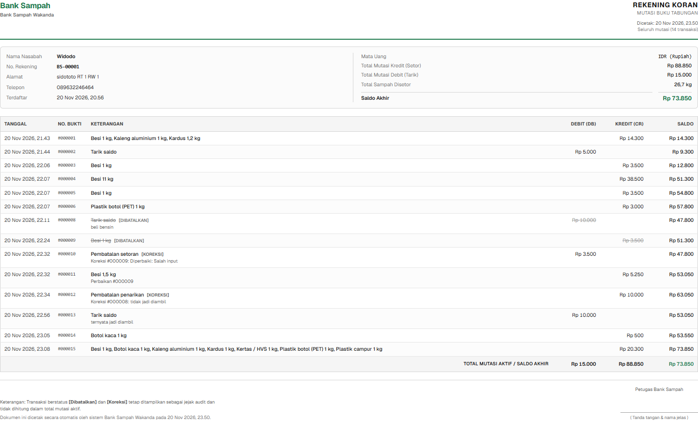
</p>

### Transaksi Setor, Tarik & Koreksi

- Pencarian nasabah berjalan langsung di server sehingga tetap ringan meski jumlah nasabah mencapai ribuan.
- Sebelum transaksi disimpan, muncul lembar konfirmasi berisi ringkasan nominal serta peringatan otomatis bila berat atau jumlah penarikan melebihi batas wajar.
- Demi keutuhan pencatatan, transaksi tidak pernah dihapus. Kesalahan input ditangani lewat tombol **Perbaiki** atau **Batalkan** yang otomatis mencatat transaksi pembalik saldo.

<table>
  <tr>
    <td width="50%" align="center" valign="top">
      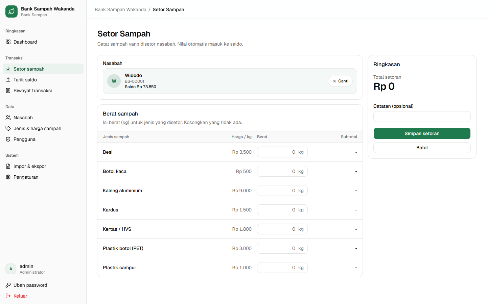
      <br /><sub><b>Setor Sampah</b> — dukung banyak jenis sekaligus dengan hitung subtotal otomatis</sub>
    </td>
    <td width="50%" align="center" valign="top">
      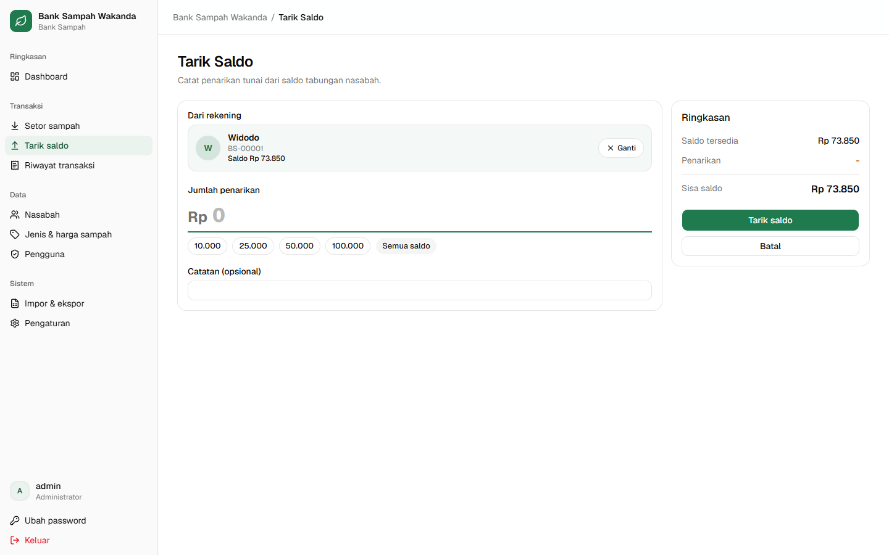
      <br /><sub><b>Tarik Saldo</b> — tombol nominal cepat &amp; pratinjau sisa saldo</sub>
    </td>
  </tr>
  <tr>
    <td width="50%" align="center" valign="top">
      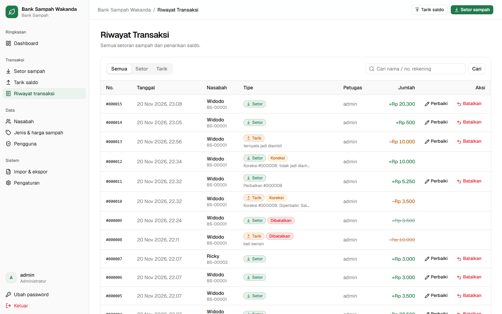
      <br /><sub><b>Riwayat Transaksi</b> — filter tipe, pencarian, serta aksi Perbaiki &amp; Batalkan</sub>
    </td>
    <td width="50%" align="center" valign="top">
      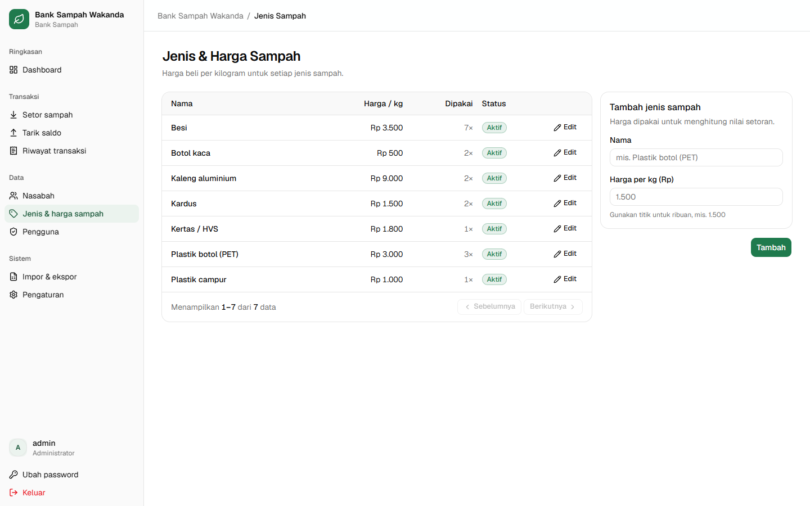
      <br /><sub><b>Jenis &amp; Harga Sampah</b> — ubah harga per kg tanpa mengubah riwayat lama</sub>
    </td>
  </tr>
</table>

### Pengguna, Impor/Ekspor Excel & Pengaturan

Pengelola dapat mengatur akun akses petugas maupun nasabah, memindahkan data dari buku catatan manual melalui file Excel (`.xlsx`), serta menyesuaikan seluruh identitas dan aturan aplikasi melalui 3 tab pengaturan.

<table>
  <tr>
    <td width="50%" align="center" valign="top">
      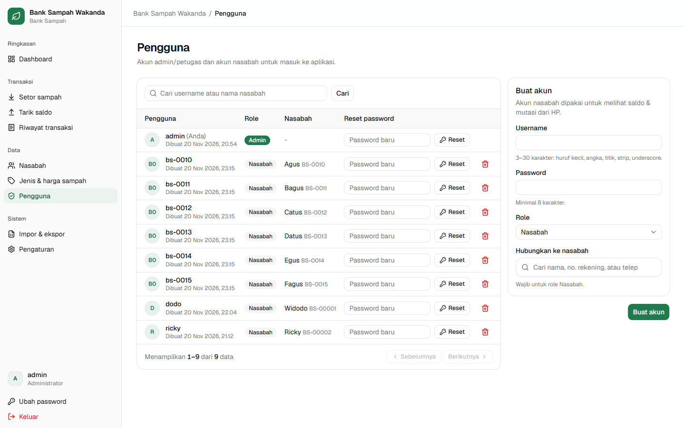
      <br /><sub><b>Pengguna</b> — tambah akun admin/nasabah, reset password &amp; hapus akun</sub>
    </td>
    <td width="50%" align="center" valign="top">
      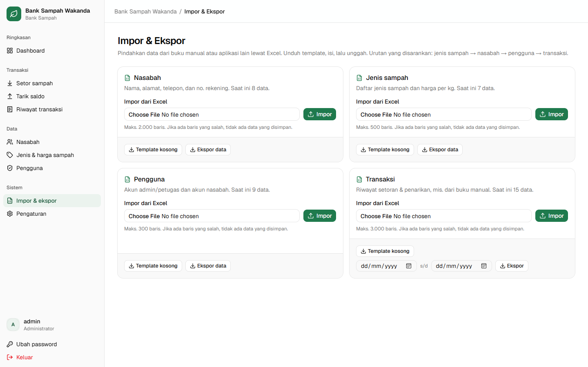
      <br /><sub><b>Impor &amp; Ekspor Excel</b> — unduh template &amp; validasi menyeluruh sebelum simpan</sub>
    </td>
  </tr>
  <tr>
    <td width="50%" align="center" valign="top">
      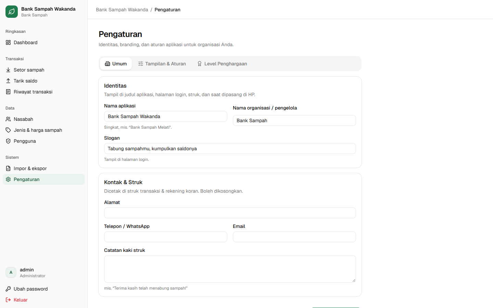
      <br /><sub><b>Pengaturan · Umum</b> — nama aplikasi, organisasi, kontak &amp; catatan kaki struk</sub>
    </td>
    <td width="50%" align="center" valign="top">
      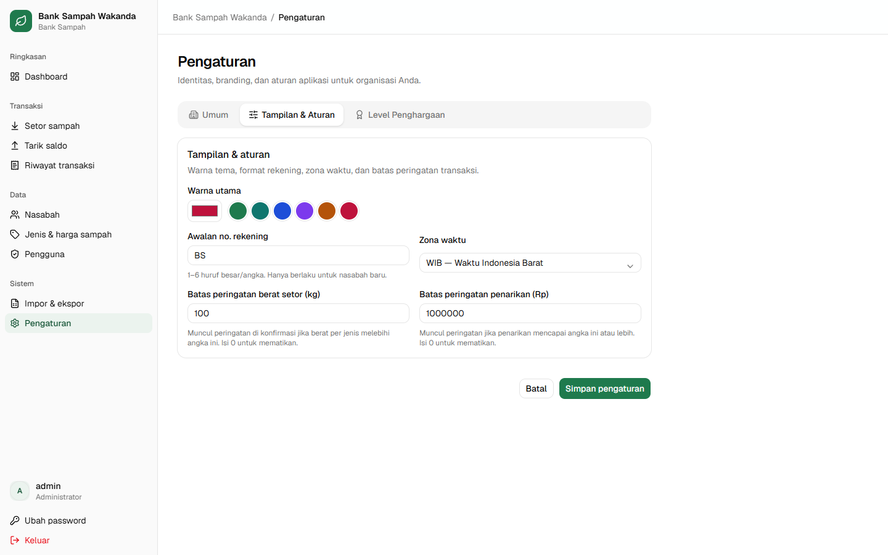
      <br /><sub><b>Pengaturan · Tampilan &amp; Aturan</b> — warna tema, zona waktu &amp; batas peringatan</sub>
    </td>
  </tr>
</table>

<p align="center">
  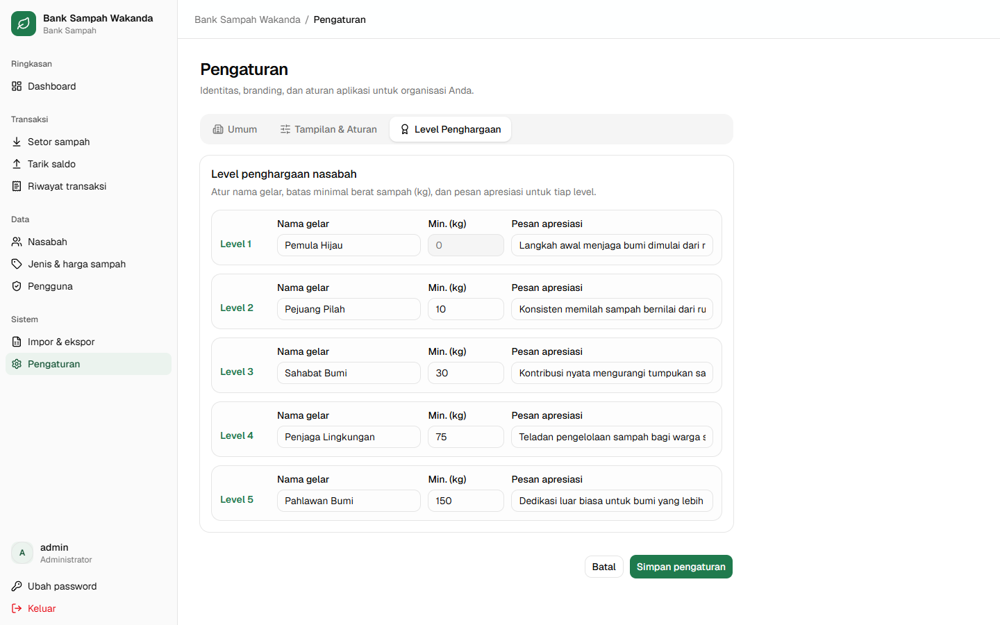
  <br /><sub><b>Pengaturan · Level Penghargaan</b> — sesuaikan nama gelar, minimal berat (kg) &amp; pesan apresiasi</sub>
</p>

### Tampilan Nasabah di Ponsel

Dirancang nyaman dibuka dari layar ponsel dan dapat dipasang ke layar utama (_PWA_). Nasabah dapat menyembunyikan saldo, menyalin nomor rekening dengan sekali ketuk, memantau progres level penghargaan beserta dampak lingkungannya, serta mengecek harga sampah yang berlaku.

<table>
  <tr>
    <td width="33%" align="center" valign="top">
      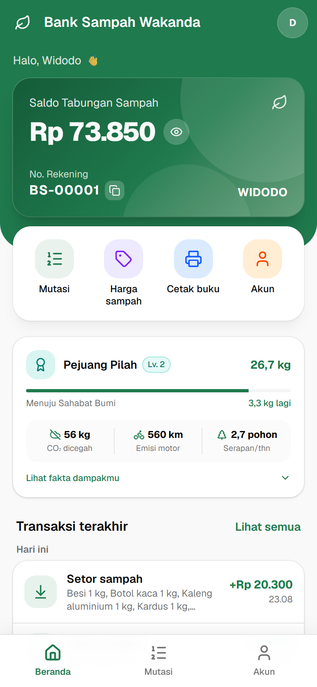
      <br /><sub><b>Beranda Nasabah</b><br />Kartu saldo, progres level &amp; dampak bumi</sub>
    </td>
    <td width="33%" align="center" valign="top">
      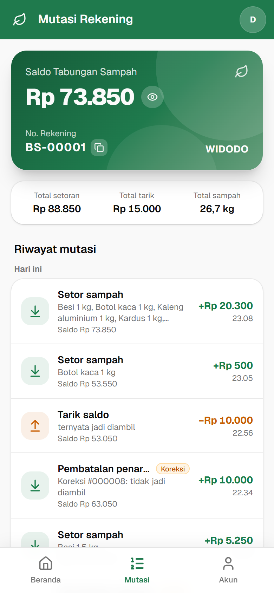
      <br /><sub><b>Mutasi Rekening</b><br />Ringkasan total &amp; riwayat per hari</sub>
    </td>
    <td width="33%" align="center" valign="top">
      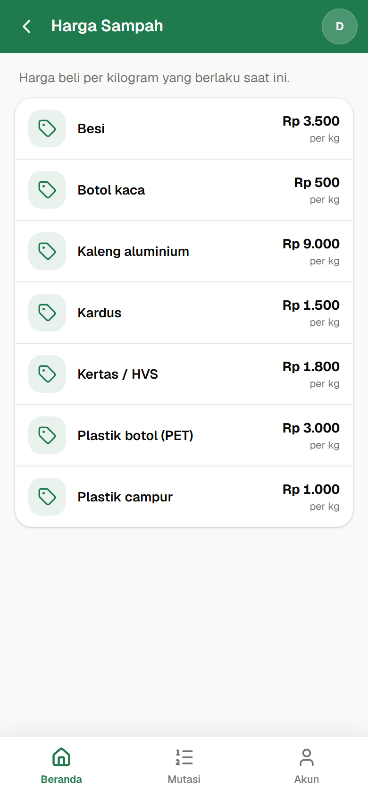
      <br /><sub><b>Daftar Harga</b><br />Harga beli sampah aktif per kg</sub>
    </td>
  </tr>
</table>

### Tampilan Admin di Ponsel

Seluruh menu operasional petugas juga tersedia dalam tata letak responsif dengan navigasi bawah agar pencatatan tetap praktis dilakukan langsung di lokasi penimbangan.

<table>
  <tr>
    <td width="33%" align="center" valign="top">
      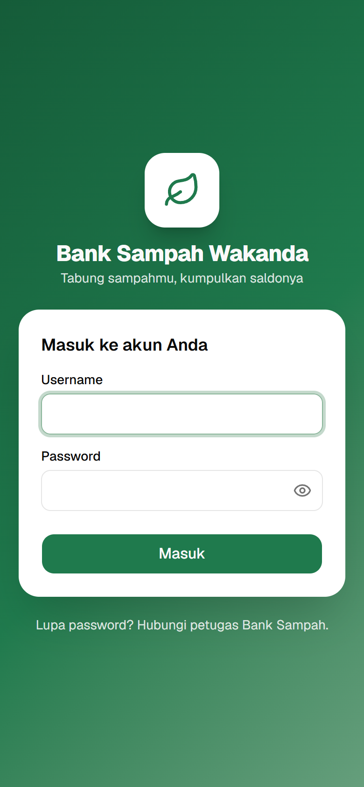
      <br /><sub><b>Login</b></sub>
    </td>
    <td width="33%" align="center" valign="top">
      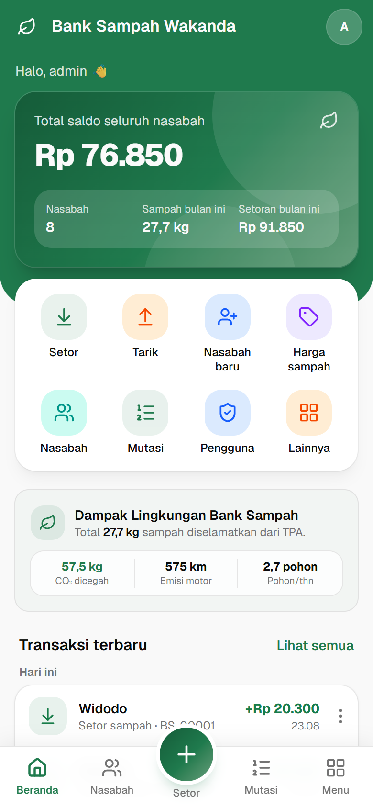
      <br /><sub><b>Dashboard Admin</b></sub>
    </td>
    <td width="33%" align="center" valign="top">
      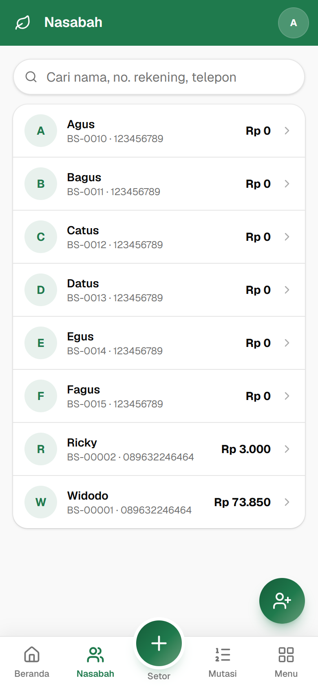
      <br /><sub><b>Daftar Nasabah</b></sub>
    </td>
  </tr>
  <tr>
    <td width="33%" align="center" valign="top">
      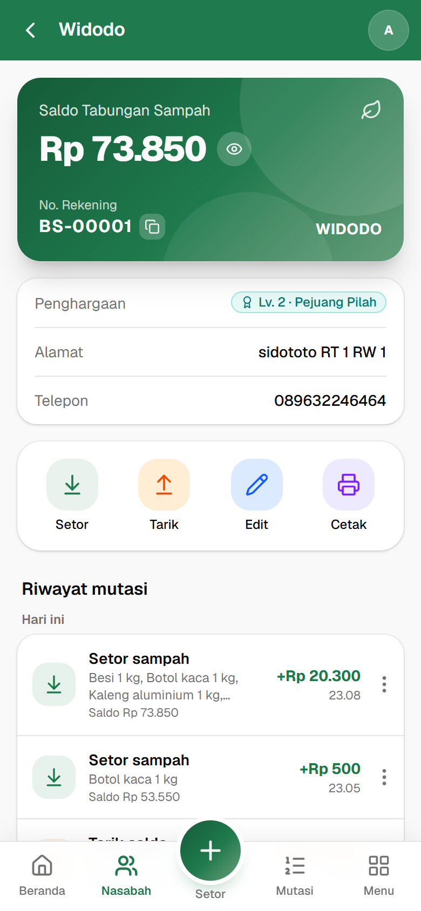
      <br /><sub><b>Buku Tabungan</b></sub>
    </td>
    <td width="33%" align="center" valign="top">
      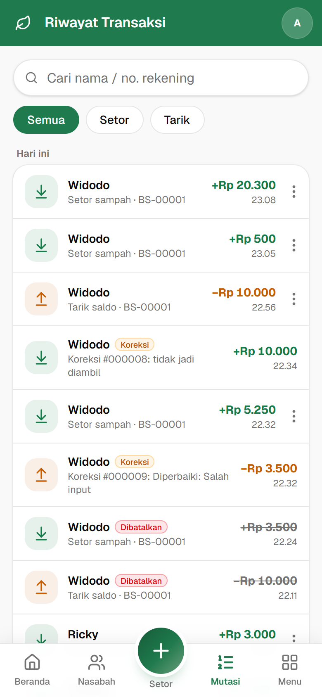
      <br /><sub><b>Riwayat Transaksi</b></sub>
    </td>
    <td width="33%" align="center" valign="top">
      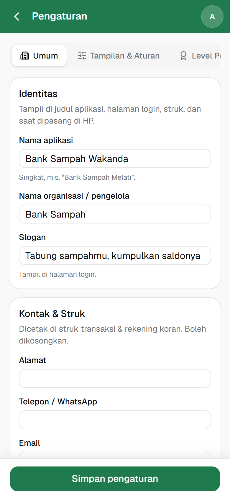
      <br /><sub><b>Pengaturan</b></sub>
    </td>
  </tr>
</table>

---

## Menjalankan di Komputer Lokal

1. Siapkan database PostgreSQL lokal atau buat database gratis di [Neon](https://neon.tech).
2. Jika memakai Neon, salin dua _connection string_ dari menu **Connect**:
   - **Pooled** (host berisi `-pooler`) → `DATABASE_URL`
   - **Direct** (tanpa `-pooler`) → `DATABASE_URL_UNPOOLED`
3. Salin contoh konfigurasi dan jalankan aplikasi:

```bash
cp .env.example .env        # sesuaikan DATABASE_URL, DATABASE_URL_UNPOOLED, ADMIN_PASSWORD
npm install
npx prisma migrate deploy   # atau `npm run db:migrate` saat pengembangan
npm run db:seed             # membuat akun admin awal & contoh jenis sampah
npm run dev                 # buka http://localhost:4321
```

---

## Deploy ke Vercel

1. Push repositori ini ke GitHub, lalu pilih **Import Project** di Vercel (Astro terdeteksi otomatis).
2. Hubungkan database PostgreSQL di **Storage → Neon** (`DATABASE_URL` dan `DATABASE_URL_UNPOOLED` akan terisi otomatis, atau isi manual di **Settings → Environment Variables**).
3. Jalankan deploy. Vercel mengeksekusi skrip `vercel-build` (`prisma migrate deploy && astro build`), sehingga skema database otomatis diperbarui setiap deploy.
4. Buat akun admin **sekali saja** dari komputer lokal dengan `.env` yang mengarah ke database produksi:

```bash
npm run db:seed
```

Catatan untuk Vercel:

- File `vercel.json` sudah mengatur region fungsi ke **Singapore (`sin1`)** agar dekat dengan Indonesia dan satu region dengan database Neon Singapore.
- `prisma.config.ts` otomatis mengarahkan migrasi ke koneksi Direct Neon (tanpa `-pooler`), dan `vercel-build` menonaktifkan _advisory lock_ agar migrasi berjalan mulus di Vercel.
- Domain `*.vercel.app` terdaftar otomatis di `allowedDomains`. Jika memakai domain sendiri, tambahkan `ALLOWED_DOMAINS="banksampah.desaku.id"` di Environment Variables lalu **redeploy**.
- Karena Vercel berjalan di atas HTTPS, cookie sesi otomatis bersifat `secure` tanpa perlu mengisi `COOKIE_SECURE`.
- Paket gratis Neon akan menidurkan database saat tidak aktif, sehingga permintaan pertama setelah jeda lama mungkin memerlukan 1–2 detik.

---

## Deploy ke VPS Sendiri (Docker Compose)

Untuk menjalankan aplikasi sekaligus PostgreSQL di server/VPS sendiri:

1. Salin `.env.example` menjadi `.env`, lalu isi bagian **1, 2, dan 3A** (`ADMIN_PASSWORD`, `ALLOWED_DOMAINS`, `POSTGRES_PASSWORD`, `APP_PORT`):
   - **Menggunakan domain + HTTPS** (Nginx / Caddy / Cloudflare Tunnel): isi `ALLOWED_DOMAINS="banksampah.desaku.id"` dan biarkan `COOKIE_SECURE=""`.
   - **Menggunakan IP HTTP tanpa SSL**: isi `ALLOWED_DOMAINS="IP_VPS_ANDA"` dan `COOKIE_SECURE="false"`.
2. Build dan jalankan container (migrasi database berjalan otomatis saat container `app` menyala):

```bash
cp .env.example .env
nano .env
docker compose up -d --build
```

3. Buat akun admin awal & contoh jenis sampah **sekali saja**:

```bash
docker compose exec app npm run db:seed
```

4. Aplikasi siap diakses di `http://IP_VPS:4321` (atau arahkan _reverse proxy_ ke `127.0.0.1:4321`). Data PostgreSQL tersimpan persisten pada Docker volume `pgdata`.

---

## Pengaturan & Kustomisasi

Masuk sebagai admin lalu buka menu **Pengaturan**. Semua perubahan tersimpan di database (`AppConfig`) sehingga langsung aktif tanpa perlu build ulang:

| Tab                   | Yang Bisa Diatur                                                                                                                                                                                  | Dampak di Aplikasi                                                                                    |
| --------------------- | ------------------------------------------------------------------------------------------------------------------------------------------------------------------------------------------------- | ----------------------------------------------------------------------------------------------------- |
| **Umum**              | Nama aplikasi, nama organisasi, slogan, alamat, telepon, email, catatan kaki struk                                                                                                                | Judul halaman, sidebar, halaman login, manifest PWA, kop & kaki struk / rekening koran                |
| **Tampilan & Aturan** | Mode tema aplikasi (Terang/Gelap/Sistem), 8 preset skema warna & kustom, live preview kartu, awalan no. rekening, zona waktu (`WIB/WITA/WIT`), batas peringatan berat setor (kg) & penarikan (Rp) | Seluruh tema tampilan, kartu, sidebar, warna PWA, format waktu, serta peringatan di lembar konfirmasi |
| **Level Penghargaan** | Nama gelar, batas minimal berat kumulatif (kg), pesan apresiasi (Level 1–5)                                                                                                                       | Beranda nasabah (`/me`) & lencana profil di buku tabungan                                             |

---

## Impor & Ekspor Data Excel

Menu **Impor & Ekspor** menyediakan template `.xlsx` (terdiri dari sheet **Data** dan **Petunjuk**) untuk mempermudah migrasi data lama maupun pencadangan berkala:

- **Jenis sampah**: nama, harga per kg, status aktif (nama yang sama otomatis memperbarui harga).
- **Nasabah**: nomor rekening (kosong = otomatis, atau gunakan nomor lama), nama, alamat, telepon.
- **Pengguna**: username, password, peran (Nasabah/Admin), nomor rekening terkait.
- **Transaksi**: tanggal, nomor rekening, SETOR/TARIK, jenis sampah, berat, harga, jumlah, catatan, petugas. Baris dengan No. Bukti sama digabung menjadi satu setoran dan saldo nasabah dihitung ulang otomatis.

Urutan impor yang disarankan: **jenis sampah → nasabah → pengguna → transaksi**. Untuk memindahkan saldo awal dari buku manual, masukkan sebagai transaksi `SETOR` tanpa jenis sampah (isi kolom **Jumlah**).

Aturan impor:

- Bersifat **semua atau tidak sama sekali** — bila ada satu baris tidak valid, tidak ada data yang tersimpan dan daftar kesalahan per baris akan ditampilkan.
- Tanggal transaksi tidak boleh lebih awal dari transaksi terakhir nasabah di sistem, dan penarikan tidak boleh melebihi saldo.
- Batas per file: 2.000 nasabah, 500 jenis sampah, 300 pengguna, 3.000 baris transaksi (maks. 4 MB).

---

## Penting: `ALLOWED_DOMAINS`

Astro 7 memverifikasi header `Host` terhadap daftar `security.allowedDomains`. Jika domain atau IP yang digunakan untuk membuka aplikasi belum didaftarkan, seluruh pengiriman form (`POST`) akan ditolak dengan status `403`. Nilai ini dibaca pada saat proses build, jadi pastikan melakukan build/deploy ulang setiap kali mengubahnya.

---

## Struktur Proyek

```text
Dockerfile                     # build multi-stage untuk deploy Docker / VPS
docker-compose.yml             # layanan app + PostgreSQL untuk VPS sendiri
vercel.json                    # konfigurasi region Vercel Functions (Singapore / sin1)
prisma.config.ts               # konfigurasi Prisma CLI (URL migrasi Direct Neon & seed)
prisma/schema.prisma           # model: User, Session, LoginAttempt, Customer, WasteType, Transaction, DepositItem, AppConfig
prisma/seed.ts                 # seed admin awal & contoh jenis sampah
src/middleware.ts              # autentikasi, pembatasan peran, header keamanan & muat AppConfig
src/lib/                       # logika server (prisma, auth, config, format, period, ecoImpact, transactions, dataTransfer, spreadsheet, pagination)
src/components/ui/             # komponen dasar shadcn/ui
src/components/app/            # shell desktop, CustomerPicker, tombol tautan
src/components/views/          # tampilan halaman desktop, form, struk, rekening koran (nasabah & global), kartu dampak lingkungan
src/components/mobile/         # komponen tampilan ponsel
src/pages/                     # seluruh halaman & endpoint Astro (admin, nasabah /me, menu, manifest PWA)
docs/screenshots/              # tangkapan layar dokumentasi
```

---

## Catatan Teknis & Keamanan

- **Perlindungan Data**: Seluruh halaman, API pencarian, dan ekspor Excel dilindungi autentikasi & pembatasan peran di middleware; nasabah hanya dapat melihat transaksinya sendiri.
- **Sesi & Kata Sandi**: Cookie sesi bersifat `httpOnly` + `SameSite=Lax` (hanya hash SHA-256 disimpan di DB), kata sandi memakai `bcrypt` (cost 12, maks. 72 karakter), serta pembatas percobaan login gagal tersimpan di database (`LoginAttempt`).
- **Pertahanan Web & Ekspor**: Perlindungan CSRF bawaan Astro (`checkOrigin`), header keamanan HTTP (`X-Frame-Options`, `X-Content-Type-Options`, `Referrer-Policy`, `Permissions-Policy`), serta sanitasi sel untuk mencegah _formula injection_ saat ekspor Excel.
- **Integritas Pencatatan**: Perubahan saldo dan riwayat selalu dijalankan dalam satu `prisma.$transaction`, harga per kg disalin ke tiap `DepositItem`, dan koreksi transaksi memakai pencatatan pembalik (_void + reversal_) sehingga jejak audit tetap utuh.
- **Ringan & Mulus di Browser**: Seluruh tampilan React dirender di server tanpa beban JavaScript berlebih (kecuali grafik dashboard `client:visible` dan pencarian nasabah `client:load`), dipadukan dengan Astro `ClientRouter`, _prefetch_, _skeleton loading_, serta _partial DOM swap_ untuk filter, pencarian, dan paginasi.

---

## Lisensi

Dirilis di bawah lisensi [MIT](./LICENSE).
